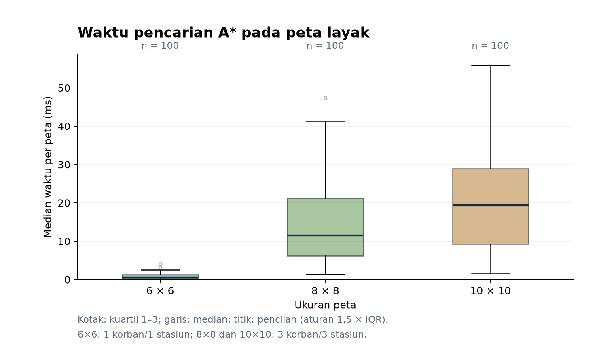
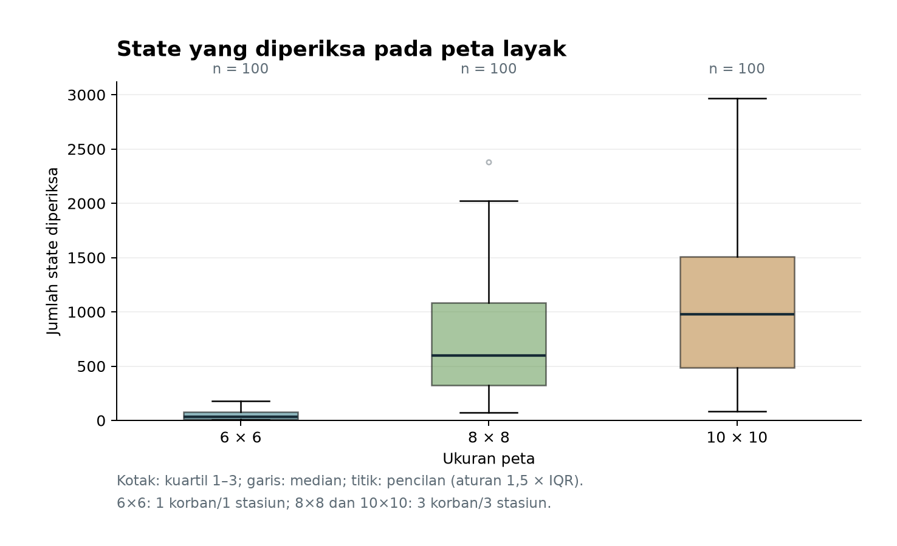
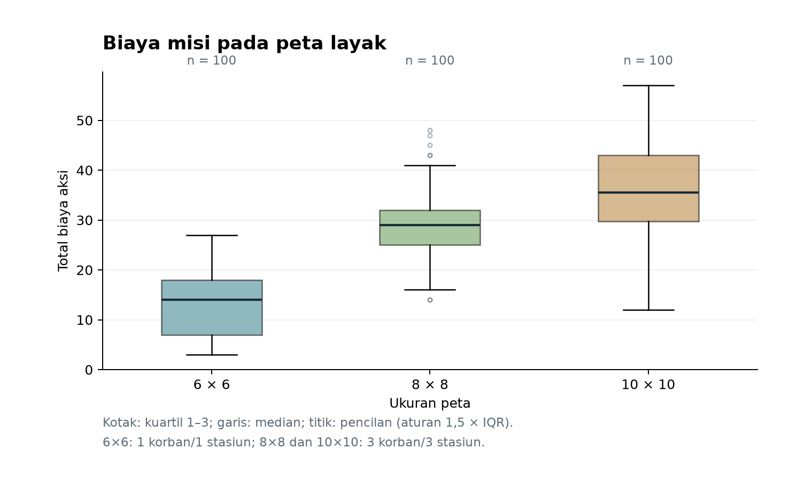
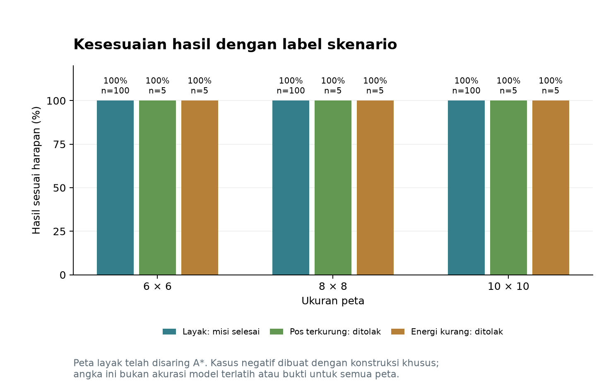

# Laporan Evaluasi A* — Robot Penyelamat

Pengujian nyata: **330 peta unik**, **5 pengulangan per peta**, dan **1650 pencarian terukur**.

- Misi selesai pada peta layak: **300/300**.
- Penolakan benar pada kasus tanpa solusi: **30/30**.
- Seluruh hasil sesuai label skenario: **330/330**.

Ini adalah evaluasi algoritma pencarian. Tidak ada pelatihan model atau pembagian training/testing.

## 1. Data dan sumbernya

Data bersifat **sintetis**. Satu baris dataset adalah satu skenario peta, bukan satu petak. Peta layak dihasilkan fungsi `buat_peta_acak()` asli main.py; fungsi tersebut sudah menyaring peta menggunakan A*. Karena itu, keberhasilan tinggi pada kelompok ini tidak membuktikan keberhasilan pada sembarang peta.

Kasus negatif dibagi dua: pos terkurung rintangan; dan seluruh korban/stasiun terhubung secara geometris tetapi berjarak lebih dari 10 langkah sebelum robot dapat mengisi energi. Label negatif dibuktikan melalui konstruksi peta dan BFS geometris, terpisah dari A* yang diuji.

Susunan grid lengkap, koordinat, seed, label, dan checksum disimpan di `data_evaluasi/skenario.jsonl`. Jumlah korban/stasiun: 6×6 memiliki 1/1; 8×8 dan 10×10 memiliki 3/3. Energi awal 10 dan biaya tiap aksi 1.

## 2. Metode pengukuran

- Memanggil `cari_rencana_astar()` asli tanpa mengubah main.py.
- Urutan skenario diacak dengan seed yang tercatat; satu warmup per peta tidak dihitung.
- Setiap peta dicari 5 kali. Timer hanya membungkus pencarian A*: pembuatan peta, validasi, GUI, cetak terminal, dan penulisan file tidak dihitung.
- Waktu per peta adalah median ulangan. Waktu pada tabel berikut adalah median antar-peta dari median tersebut.
- Semua urutan aksi dieksekusi ulang dengan aturan asli di luar timer untuk memeriksa biaya, energi, korban, dan kepulangan ke pos.
- State diperiksa adalah kondisi lengkap (posisi, energi, korban ditangani), bukan jumlah gerak robot.
- Untuk kasus tanpa solusi, counter lokal A* dibaca pada pencarian tambahan dengan observer; pencarian tersebut tidak dihitung waktunya.

## 3. Hasil peta layak

| Ukuran | Peta | Misi selesai | Biaya rata-rata | Median waktu (ms) | State rata-rata |
|---|---:|---:|---:|---:|---:|
| 6x6 | 100 | 100 | 13.03 | 0.561 | 48.68 |
| 8x8 | 100 | 100 | 29.55 | 11.494 | 733.34 |
| 10x10 | 100 | 100 | 35.39 | 19.391 | 1054.47 |

## 4. Kasus tanpa solusi

Hasil `None` pada kelompok ini adalah keluaran yang benar. Biaya rute dikosongkan, bukan ditulis nol.

| Ukuran | Jenis | Peta | Penolakan benar | Median waktu (ms) | State rata-rata |
|---|---|---:|---:|---:|---:|
| 6x6 | pos_terkurung | 5 | 5 | 0.007 | 1.00 |
| 6x6 | energi_tidak_cukup | 5 | 5 | 0.544 | 43.00 |
| 8x8 | pos_terkurung | 5 | 5 | 0.007 | 1.00 |
| 8x8 | energi_tidak_cukup | 5 | 5 | 0.388 | 37.00 |
| 10x10 | pos_terkurung | 5 | 5 | 0.009 | 1.00 |
| 10x10 | energi_tidak_cukup | 5 | 5 | 0.394 | 36.00 |

## 5. Grafik

## 6. Batas interpretasi

- Ukuran peta 6×6 juga memiliki korban/stasiun lebih sedikit. Perbedaan waktu tidak dapat diatribusikan hanya kepada ukuran grid.
- Peta layak sudah dipilih oleh A*. Kasus negatif merupakan kasus terstruktur, bukan sampel semua kemungkinan peta.
- Belum ada pembanding UCS atau pengukuran optimalitas independen; hasil ini tidak membuktikan A* lebih cepat dari algoritma lain.
- Waktu bergantung pada perangkat, versi Python, dan beban komputer. Ulangi pada kondisi yang konsisten untuk perbandingan baru.

## 7. Kalimat untuk progres dosen

> Saya menguji A* pada 330 skenario peta sintetis. Sebanyak 300 peta layak dan 30 kasus tanpa solusi dilaporkan terpisah. Setiap peta diuji 5 kali. Evaluasinya meliputi keberhasilan misi, biaya aksi, waktu pencarian, dan jumlah state yang diperiksa.

## 8. Jejak eksperimen

- Waktu mulai (Asia/Jakarta): `2026-11-11T14:21:40+07:00`.
- Python: `3.13.15`; OS: `Windows-11-10.0.26300-SP0`; CPU: `Intel64 Family 6 Model 186 Stepping 2, GenuineIntel`.
- Seed urutan pengujian: `20261112`.
- SHA-256 main.py: `21da441fb1bb4cfe3e86f4fefd0ce30470e1e25bf0280f916c3a1babd7503669`.
- SHA-256 dataset: `efa04e173888b721ae3f6b007bc10a6ee0c23f6be440f65c42ee4e134e079db3`.
- Checksum teks memakai akhir baris LF agar konsisten antara checkout Windows dan Linux.
- Data hasil: [per peta](hasil_per_peta.csv), [setiap ulangan](waktu_per_ulangan.csv), [ringkasan](ringkasan.csv), [metadata](metadata_run.json).
